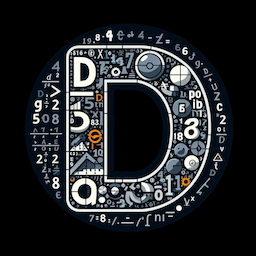

# Decimo (formerly DeciMojo) <!-- omit from toc -->

An arbitrary-precision integer, decimal, binary floating-point, and rational library for Mojo, written in pure Mojo, with a 128-bit fixed-point decimal type as well.

## Overview

Decimo provides an arbitrary-precision integer and decimal library for Mojo. It delivers exact calculations for financial modeling, scientific computing, and applications where floating-point approximation errors are unacceptable. Beyond basic arithmetic, the library includes advanced mathematical functions with guaranteed precision.

For Pythonistas, `decimo.BigInt` to Mojo is like `int` to Python, and `decimo.BigDecimal` to Mojo is like `decimal.Decimal` to Python. `decimo.Decimal128` to Mojo is like `System.Decimal` to C# or `rust_decimal` to Rust.

The core types are:

| Type         | Alias             | Information                                                                             | Layout       |
| ------------ | ----------------- | --------------------------------------------------------------------------------------- | ------------ |
| `BigInt`     | `BInt`            | Arbitrary-precision binary integer type, equivalent to Python's `int` and GMP's `mpz`   | Base-2^64    |
| `BigDecimal` | `BDec`, `Decimal` | Arbitrary-precision decimal type, equivalent to Python's `decimal.Decimal` and libmpdec | Base-10^18   |
| `BigFloat`   | `BFlt`            | Arbitrary-precision binary float type, equivalent to MPFR's `mpfr_t`                    | Base-2^64    |
| `Rational`   | `Frac`            | Exact rational number type, equivalent to Python's `fractions.Fraction`                 | Two `BigInt` |
| `Decimal128` | `Dec128`          | 128-bit fixed-precision decimal type, equivalent to C#/.NET's `System.Decimal`          | 32-bit words |

**Decimo** combines "**Deci**mal" and "**Mo**jo" - reflecting its purpose and implementation language. "Decimo" is also a Latin word meaning "tenth" and is the root of the word "decimal".

## Documentation

The [README](https://github.com/forfudan/decimo#readme) has a quick start and the installation instructions; the [user manual](https://github.com/forfudan/decimo/blob/main/docs/user_manual.md) is the full tour; the [changelog](https://github.com/forfudan/decimo/blob/main/docs/changelog.md) records what each release changed, and the [benchmarks](https://github.com/forfudan/decimo/blob/main/docs/benchmarks.md) carries the measurements.

## License

Apache License 2.0. See [LICENSE](https://github.com/forfudan/decimo/blob/main/LICENSE).
